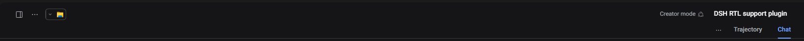

# DSH RTL + وزیرمتن

[English](README.md) | **فارسی**

یک پلاگین ماندگار برای [DeepSeek Harness](https://github.com/deepseek-ai/deepseek-harness) که
چیدمان راست‌به‌چپ و قلم [وزیرمتن](https://github.com/rastikerdar/vazirmatn) را بدون فورک‌کردن
هارنس به رابط وب اضافه می‌کند.


## چرا

رابط وب DSH چپ‌به‌راست و با قلم سیستم عرضه می‌شود. برای فارسی — یا هر زبان راست‌به‌چپ — این یعنی
چیدمان باید دستی آینه شود و قلم هم روی هر سیستمی فرق می‌کند. این پلاگین یک لایهٔ مستقل و
قابل‌برگشت است: یک ردیف در لودر، فونت داخل خودِ بسته، بدون CDN فونت و بدون هیچ تغییری در خود DSH.

## امکانات

- **سه حالت جهت‌دهی** با یک کلید در نوار کنار و به‌خاطر سپردن انتخاب در مرورگر: RTL کامل، RTL فقط
  چت، و LTR.
- **وزیرمتن همراه بسته است** (فونت متغیر با وزن ۱۰۰ تا ۹۰۰، WOFF2 درون `client.js`)، پس متن فارسی
  روی هر سیستمی یکسان دیده می‌شود؛ آفلاین، بدون نصب فونت و بدون پرش چیدمان.
- **کد چپ‌به‌راست می‌ماند**: بلوک کد، کد درون‌خطی، خروجی ترمینال و ویرایشگرها ترتیب خواندن طبیعی
  خود را حتی داخل یک گفتگوی راست‌به‌چپ حفظ می‌کنند.
- **حالت فقط چت دقیق است**: فقط متن گفتگو و کادر نوشتن را آینه می‌کند و هدر گفتگو و ردیف دکمه‌های
  چت‌باکس را عمداً دست‌نخورده می‌گذارد.
- **اصلاح سطوح فیزیکیِ هاست**: تورفتگی لیست‌ها و نقل‌قول‌ها، حاشیهٔ خودکار گروه دکمه‌های انتهایی
  کامپوزر، پدینگ کادر نوشتن، جای اسکرول‌بار، و دکمه‌های نوار عنوان ویندوز.
- **چرخهٔ عمر تمیز**: با غیرفعال‌کردن بسته، استایل، اتریبیوت `dir` و نشانگر حالت حذف می‌شوند و
  وضعیت قبلی برمی‌گردد.

## حالت‌ها

| حالت | چه چیزی آینه می‌شود |
| --- | --- |
| `RTL` | کل رابط (`dir="rtl"` روی سند). |
| `Chat RTL` | فقط متن گفتگو و کادر نوشتن کامپوزر. |
| `LTR` | هیچ‌چیز — قلم وزیرمتن همچنان اعمال می‌شود. |

کلید تغییر حالت کنار «تنظیمات» در پایین نوار کنار قرار دارد و هر کلیک حالت را یکی جلو می‌برد.
انتخاب در `localStorage` با کلید `@local/dsh-rtl-vazirmatn:mode` ذخیره می‌شود.

## تصویر

هدر چتِ آینه‌شده در حالت RTL کامل:



## نصب

پیش‌نیاز: نسخه‌ای از DeepSeek Harness با پشتیبانی پروفایل (اپ دسکتاپ یا `dsh web`).

1. مخزن را در یک پوشهٔ ثابت کلون کنید.
2. در DSH به **Settings → Plugins** بروید و بسته را از همان پوشه نصب کنید. اگر با ایجنت کار
   می‌کنید، معادلش اجرای action نصبِ `plugin_manager` با مسیر همان پوشه است.
3. ردیف *RTL layout with Vazirmatn* ظاهر می‌شود و رابط بلافاصله پلاگین را اعمال می‌کند. اگر بستهٔ
   نصب‌شدهٔ قبلی جایگزین شده باشد، یک‌بار صفحه را رفرش کنید تا بستهٔ تازهٔ کلاینت بار شود.

راه دستی: یک وابستگی `link:` به این پوشه در `package.json` پروفایل اضافه کنید و بسته را در
`dsh.profile.bundles` فهرست کنید، سپس DSH را دوباره راه‌اندازی کنید.

## نحوهٔ کار

### جهت

حالت کامل `dir="rtl"` را روی `<html>` می‌گذارد؛ ردیف‌های فلکس، جریان درون‌خطی، کنترل‌های فرم و
اسکرول‌بارها از همان آینه می‌شوند. حالت فقط چت به سند دست نمی‌زند و `direction: rtl` را روی دو
عنصر پایدار هاست اعمال می‌کند:

- `[data-chat-flow]` — ستون پیام‌ها؛
- `[data-input-scroll]` — کادر نوشتن کامپوزر.

### قلم

`client.js` یک فایل WOFF2 متغیر وزیرمتن را به‌صورت `data:` URI در خود جای می‌دهد و متغیرهای قلم
متن تم (`--dsh-font-family-text` و `--dsw-font-family`) را بازنویسی می‌کند. متغیرهای قلم کد و
ترمینال دست‌نخورده می‌مانند تا سطوح مونواسپیس تغییر نکنند. در زمان اجرا هیچ درخواست شبکه‌ای انجام
نمی‌شود.

### اصلاح‌های RTL

چند سطح از هاست با `margin-left`/`left` فیزیکی چیده شده‌اند. پلاگین آن‌ها را برای ردیف کامپوزر و
نوار عنوان ویندوز با نام کلاس‌های CSS-module همان بیلد هدف می‌گیرد و جاهای دیگر از اتریبیوت‌های
داده‌ای پایدار استفاده می‌کند. اگر DSH آن نام‌ها را تغییر دهد، فقط همان قاعده بی‌اثر می‌شود و
چیدمان به حالت آینه‌شدهٔ ساده برمی‌گردد؛ چیزی نمی‌شکند.

### چرخهٔ عمر

همه‌چیز از طریق کانتکست پلاگین ثبت می‌شود: استایل یک عنصر `<style>` متعلق به بسته است که هنگام
dispose حذف می‌شود، و اتریبیوت‌های `dir` و `data-dsh-rtl` به مقدار قبل از فعال‌سازی برمی‌گردند.

## ساختار پروژه

| مسیر | نقش |
| --- | --- |
| `client.template.js` | سورس پلاگین مرورگر؛ جای‌نگهدار فونت داخلش است. |
| `client.js` | بستهٔ تولیدشده که DSH زیر `/plugins` سرو می‌کند (فونت درون‌بسته). |
| `index.js` | نیمهٔ هاست بسته؛ چیزی ثبت نمی‌کند. |
| `cordis.patch.yml` | ردیف لودری که بسته اضافه می‌کند. |
| `locale/` | متادیتای نمایش در Plugin Manager (`en`، `fa`). |
| `assets/Vazirmatn-Variable.woff2` | فایل مبدأ فونت. |
| `tools/build-client.mjs` | مرحلهٔ ساخت بدون وابستگی (نسخهٔ PowerShell هم موجود است). |
| `docs/` | تصاویر. |

## توسعه

```sh
node tools/build-client.mjs
node --check client.js
```

`client.js` تولیدشده است: `client.template.js` (و CSS داخلش) را ویرایش کنید و دوباره بسازید. بعد از
بازسازیِ یک نسخهٔ نصب‌شده، ردیف لودر را دوباره راه‌اندازی کنید — پلاگین را غیرفعال/فعال کنید یا
صفحه را رفرش کنید — تا مرورگر بستهٔ تازه را بگیرد.

مرحلهٔ ساخت هیچ وابستگی ندارد و فقط WOFF2 را به base64 تبدیل و درون‌بسته می‌کند.

## سازگاری

با DeepSeek Harness نسخهٔ `0.2.2-rc.1` (دسکتاپ، ویندوز، کرومیوم) ساخته و آزمایش شده است. بسته از
قرارداد مستندشدهٔ پلاگین کلاینت استفاده می‌کند: مانیفست `dsh.client`، خروجی `./client` و فکتوری
`window.__ModuleLoader__.load`.

## مجوز

کد تحت MIT © ۲۰۲۶ Pourii. قلم همراه وزیرمتن © صابر راستیکردار و مشارکت‌کنندگان، تحت مجوز
SIL OFL 1.1 — فایل‌های [`OFL.txt`](OFL.txt) و [`AUTHORS.txt`](AUTHORS.txt).

---

[English](README.md)
