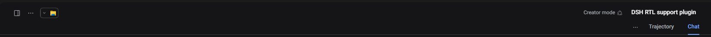

# DSH RTL + Vazirmatn

**English** | [فارسی](README.fa.md)

A persistent [DeepSeek Harness](https://github.com/deepseek-ai/deepseek-harness) plugin that adds
right-to-left layout and the [Vazirmatn](https://github.com/rastikerdar/vazirmatn) typeface to the
web UI — without forking the harness.


## Why

The DSH web UI ships as a left-to-right, system-font interface. For Persian — or any RTL
language — that means mirrored layouts and font inconsistencies out of the box. This plugin is a
self-contained, reversible layer: one loader row, the font bundled inside the client bundle, no
external font CDN, and no edits to DSH itself.

## Features

- **Three direction modes**, cycled from a sidebar switch and remembered per browser:
  full RTL, chat-only RTL, and LTR.
- **Vazirmatn is bundled** (variable, weights 100–900, WOFF2 inlined in `client.js`), so Persian
  text renders identically on every machine, offline, without a flash of missing font.
- **Code stays left-to-right**: code blocks, inline code, terminal output, and editors keep their
  natural reading order inside an RTL transcript.
- **Chat-only mode is surgical**: it mirrors the transcript and the composer's text field through
  stable host hooks, and deliberately leaves the conversation header and the composer's button row
  untouched.
- **RTL repairs** for host chrome that is positioned physically: markdown indents, the composer's
  trailing-control auto margin, text padding, scrollbar clearance, and the Windows titlebar sidebar
  buttons.
- **Clean lifecycle**: disabling the bundle removes its stylesheet, the `dir` attribute, and the
  mode marker, restoring the previous state.

## Modes

| Mode | What mirrors |
| --- | --- |
| `RTL` | The whole interface (`dir="rtl"` on the document). |
| `Chat RTL` | The message transcript and the composer text field only. |
| `LTR` | Nothing — Vazirmatn still applies. |

The switch sits beside Settings in the sidebar footer; each click advances the mode. The choice is
stored in `localStorage` under `@local/dsh-rtl-vazirmatn:mode`.

## Screenshot

The mirrored chat header in full RTL mode:



## Install

Requires a DeepSeek Harness build with profile support (the desktop app or `dsh web`).

1. Clone this repository into a stable folder.
2. In DSH, open **Settings → Plugins** and install the bundle from that folder. When working with
   the agent, the equivalent is the `plugin_manager` install action with the folder path.
3. The *RTL layout with Vazirmatn* row appears and the interface applies the plugin immediately. If
   a previously installed copy was replaced, reload the page once so the fresh client bundle is
   fetched.

Manual alternative: add a `link:` dependency for this folder to the profile `package.json` and list
the package in `dsh.profile.bundles`, then restart DSH.

## How it works

### Direction

Full mode sets `dir="rtl"` on `<html>`; flex rows, inline flow, form controls, and scrollbars
mirror from it. Chat-only mode never touches the document: it applies `direction: rtl` to two host
elements that stay stable across DSH releases:

- `[data-chat-flow]` — the message column;
- `[data-input-scroll]` — the composer's text field.

### Typeface

`client.js` embeds a variable Vazirmatn WOFF2 as a `data:` URI and overrides the theme's text-font
variables (`--dsh-font-family-text`, `--dsw-font-family`). Code and terminal font variables are
left alone, so monospace surfaces keep their stacks. Nothing is fetched at runtime.

### RTL repairs

A few host surfaces are positioned with physical `margin-left`/`left` values. The plugin targets
them by their shipped CSS-module class names for the composer row and the Windows titlebar, and by
stable data attributes elsewhere. If DSH rebuilds those class names, the affected rule simply stops
matching and the layout falls back to the plain mirrored default instead of breaking.

### Lifecycle

Everything is registered through the plugin context: the stylesheet is a package-owned `<style>`
element removed on dispose, and the `dir` / `data-dsh-rtl` attributes are restored to their
pre-activation values.

## Project layout

| Path | Role |
| --- | --- |
| `client.template.js` | Browser plugin source; contains the font placeholder. |
| `client.js` | Generated bundle served by DSH under `/plugins`, with the font inlined. |
| `index.js` | Host half of the bundle; registers nothing. |
| `cordis.patch.yml` | Loader row inserted by the bundle. |
| `locale/` | Plugin Manager display metadata (`en`, `fa`). |
| `assets/Vazirmatn-Variable.woff2` | Source font. |
| `tools/build-client.mjs` | Dependency-free build step (PowerShell alternative included). |
| `docs/` | Screenshots. |

## Development

```sh
node tools/build-client.mjs
node --check client.js
```

`client.js` is generated: edit `client.template.js` (including the CSS inside it) and rebuild. After
rebuilding an installed copy, restart the loader entry — disable and enable the plugin, or reload
the page — so the browser fetches the fresh bundle.

The build has no dependencies; it only inlines the WOFF2 as base64.

## Compatibility

Built and tested against DeepSeek Harness `0.2.2-rc.1` (desktop, Windows, Chromium). The bundle
uses the documented client-plugin contract: a `dsh.client` manifest, a `./client` export, and the
`window.__ModuleLoader__.load` factory.

## License

MIT © 2026 Pourii. The bundled Vazirmatn font is © Saber Rastikerdar and contributors, licensed
under SIL OFL 1.1 — see [`OFL.txt`](OFL.txt) and [`AUTHORS.txt`](AUTHORS.txt).

---

[فارسی](README.fa.md)
